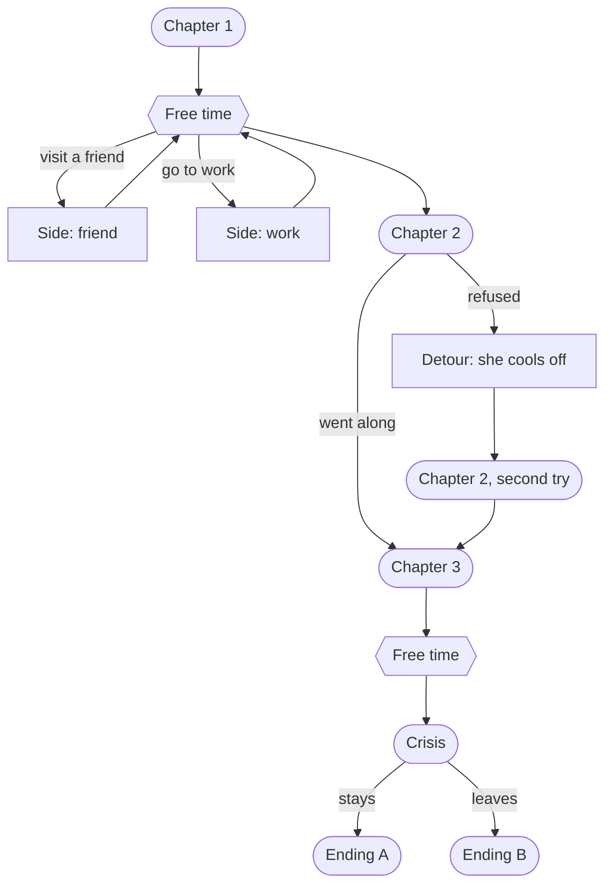
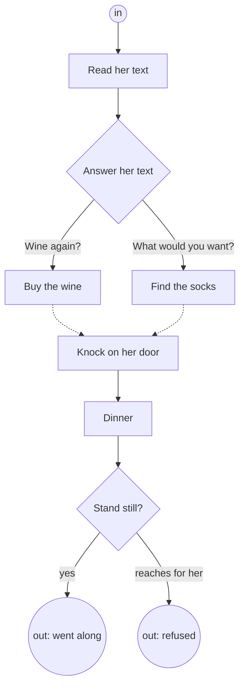

# Story graph: the model

A draft of the story graph as rules, first in plain words, then as mathematical constraints. Decided by Janosch (2026-10-26): every subgraph has exactly one entry state, any number of edges may lead into it, and nothing is remembered outside the graph.

## In plain words

- **The story is a map of boxes.** Each box is a part of the story, such as a chapter. A box can hold smaller boxes, as many levels deep as needed.
- **A box always starts the same way.** It has one door in. However the player got there, the world looks the same when they enter.
- **Inside a box, the player does things.** Each thing can need other things done first. Some needs are "all of these", some are "any one of these".
- **A choice picks one path.** Choices are few. An option may lead somewhere different, or only change what is said inside the box: nothing outside the box remembers it.
- **A box has one or more doors out.** Which door the player leaves by is the only thing the rest of the story learns. Different doors lead to different boxes.
- **The player can never get stuck.** From anywhere inside a box, some door out can still be reached.
- **Nothing is wasted.** Every thing in a box can be reached by some way of playing.
- **Boxes stay small.** A box that gets too big is split into two.
- **Going back is allowed.** A door out may lead back to an earlier box, which then starts fresh. The way out of the loop must always stay reachable.
- **Free time is a hub.** Between story boxes there can be a hub box: the player picks what to do, side boxes loop back to the hub, and the hub has one door on to the story. Free time never changes the story, so it adds nothing to the graph's size.
- **Side stories join at join points.** The main story's chapter doors are join points. A side story starts and ends between two of them, so the next chapter always starts the same way.

## In pictures

An example, not real content. **The story level**: boxes are subgraphs, and arrows are doors out. Rounded boxes are main chapters, and hexagons are hubs (free time). The detour loops back, and the crisis forks.

`Chapter 1 → Free time → Chapter 2` are join points: whatever happens in free time, Chapter 2 starts the same way. The detour does not loop back to Chapter 2 itself, since that would replay it identically. It leads into a second version of it.

**Inside one box**: one door in, things to do, one choice, two doors out. A solid arrow means "needs this". The two dashed arrows into *Knock on her door* mean "needs either".

## Definitions

A **subgraph** is G = (N, R, s, X, σ):

- N is a finite set of nodes. A node is a **gate** (something the player does), a **choice** with options o₁…oₖ (each option is itself a node), or a **subgraph** (one level down).
- R gives each node n its requirement R(n): a formula over other nodes, built from "done" with *and* and *or*. Its edges are drawn from these formulas.
- s ∈ N is the entry: the only node with no requirement.
- X ⊆ N is the set of exits. Reaching one ends G.
- σ is the world state at s. It is the same however G was entered.

Play inside G is a sequence of done nodes. Its local state is the set D ⊆ N of nodes done so far. A node n can be done when R(n) holds on D. At most one option of each choice can be in D. A child subgraph H with exits x₁…xₘ appears in G like a choice with m options, chosen by playing H.

## Constraints

1. **No cycles inside a subgraph.** Within one subgraph, the edges of R form no cycle, since a cycle of requirements can never be done. Edges between subgraphs (an exit of one leading to the entry of another) may form cycles. A subgraph entered again starts from its σ, as on its first visit.
2. **One entry.** s is the only node without requirements, and σ is fixed.
3. **Locality.** Every story variable belongs to exactly one subgraph. Only that subgraph's nodes read or write it. Nothing outside G can tell how G was played, except by which exit it left.
4. **Exits.** X is non-empty, and an exit is required by no node of G.
5. **No dead ends.** From every reachable D, some exit can still be reached. In a parent with cycles, from every child that can be reached, some exit of the parent can still be reached, so every loop has a way out.
6. **Everything reachable.** Every node is in some reachable D.
7. **Few choices.** Options of a choice may lead to the same nodes (they then only change lines inside G). The check reports such choices and counts choices per subgraph, against a cap like those in 9, but does not fail on them.
8. **Meaningful exits.** Two exits of G lead to different nodes in G's parent. Two exits that lead to the same place are one exit.
9. **Bounds.** |X| ≤ x_max and |N| ≤ n_max, with both values to be decided. A subgraph that breaks a bound is split.

## Patterns

- **Hub.** A subgraph H whose exits lead to side subgraphs that lead back to H, plus one exit onward. Side subgraphs have one exit each (back to H), so H's onward exit has the same σ whatever was played.
- **Join point.** An exit of a main-story subgraph. Every side story is a chain of subgraphs entered from a hub and closed before the next join point.

## Consequences

- **Composition.** If every subgraph meets 5 and 6, so does the whole story. Each subgraph is checked once from its one entry, so the cost is the sum over subgraphs, not their product.
- **Loops repeat exactly.** Since σ is fixed and nothing is remembered, a loop gives the same subgraph again. A loop that should play differently the second time needs its own subgraph for the second pass.
- **Levels are free.** Nesting changes nothing in the rules. A chapter is the level that means one day.
- **No callbacks.** A later scene can differ only because play reached a different subgraph. A line that refers back to an earlier choice needs that choice to be an exit that leads to its own subgraph.

## In Yarn (to be worked out)

- Every Yarn variable is tagged with its subgraph (3 can then be checked statically).
- Gates, choices and options set `$gate_*` and `$choice_*`. Exits start the next subgraph's entry node.
- The graph checks (1, 2, 4–9) run on the declared graph. A link check proves each scene sets a node only where R(n) is read.
